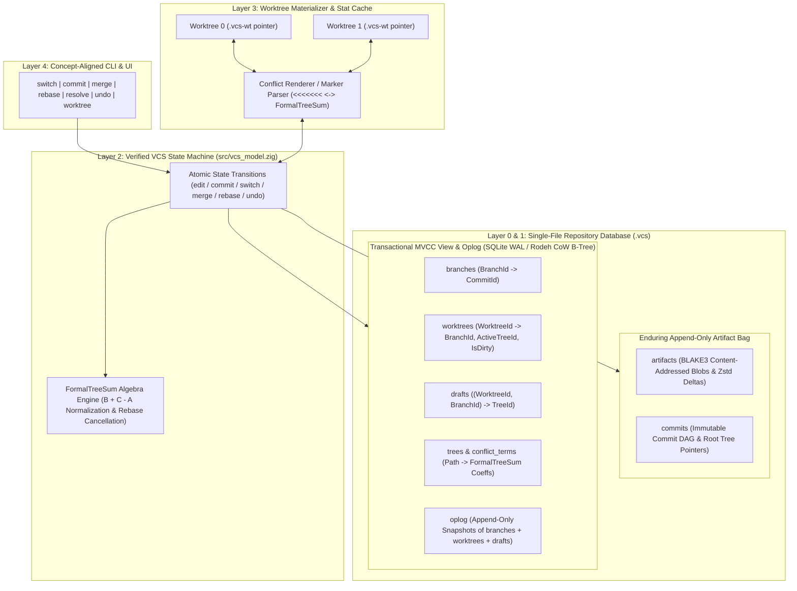
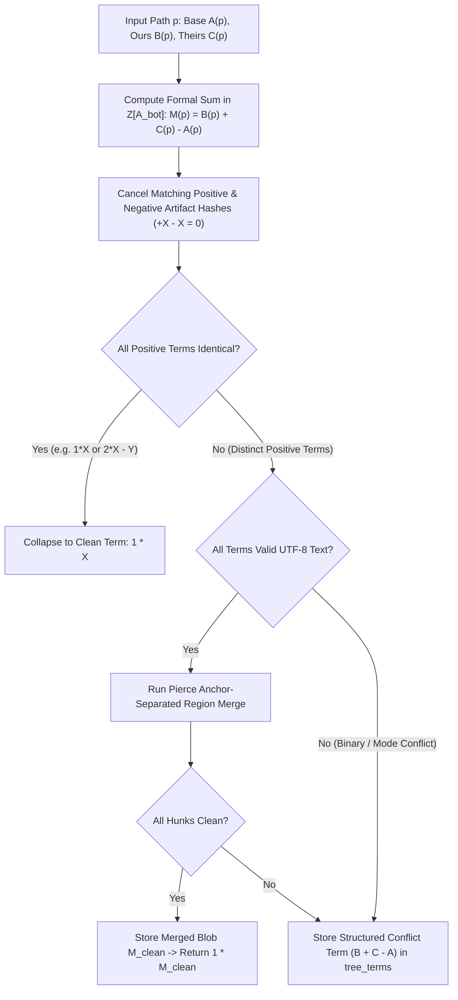

# Zig-VCS Architecture Specification

**A Formally Verified, Single-File, Multi-Worktree Version Control System**

---

## 1. Executive Summary & Design Philosophy

`zig-vcs` is a version control system architected from first principles and backed by machine-checked proofs in **Lean 4** ([`proofs/VcsProofs/Basic.lean`](file:///Users/matthewsessions/Projects/zig-vcs/proofs/VcsProofs/Basic.lean)) and an explicit-state **TLA+ model checker in Zig** ([`src/tla.zig`](file:///Users/matthewsessions/Projects/zig-vcs/src/tla.zig), [`src/vcs_model.zig`](file:///Users/matthewsessions/Projects/zig-vcs/src/vcs_model.zig)).

It unifies three foundational pillars from version control and storage systems research:

1. **Pillar 1 — Per-Branch Working State & Multi-Worktree Isolation** *(De Rosso & Jackson Onward! 2013 / OOPSLA 2016; Jujutsu)*:
   - Eliminates the staging area (`index`), `stash`, and detached `HEAD`.
   - Tracks uncommitted modifications automatically per `(worktree_id, branch_id)` in a transactional `drafts` table (or implicit working-copy commit) inside the repository database.
   - Switching branches is a **total, non-destructive operation** that automatically shelves dirty state for the old branch and restores the target branch's draft or head commit.
2. **Pillar 2 — First-Class Algebraic Conflicts ($B + C - A$)** *(Jujutsu Conflict Algebra; Kaki et al. OOPSLA 2019 MRDTs; Mimram & Di Giusto 2013 Pushouts; Khanna, Kunal, & Pierce 2007)*:
   - Never halts a merge/rebase mid-operation (`MERGE_HEAD` / `REBASE_HEAD` do not exist) and never writes `<<<<<<<` conflict markers into the storage layer.
   - Represents every tree and file state as a **formal alternating sum of clean trees** ($\sum c_i \cdot T_i$ with $\sum c_i = 1$) in the free abelian group over content hashes.
   - A 3-way merge of `ours` ($B$) and `theirs` ($C$) over common ancestor `base` ($A$) is $B + C - A$. Rebasing a conflicted commit $M = B + C - A$ from parent $C$ onto $D$ computes $(B + C - A) + D - C = B + D - A$, cancelling intermediate terms algebraically.
3. **Pillar 3 — Single-File Transactional Oplog & Storage** *(Hipp Fossil; Rodeh 2008 CoW B-Trees; Sears & Brewer OSDI 2006 Stasis)*:
   - Stores the entire repository in a **single transactional database file** (`.vcs` / `<repo>.vcs`) split into two logical layers:
     1. **Enduring Append-Only Artifact Store**: Content-addressed, delta-compressed immutable blobs, trees, and structural commit manifests.
     2. **Transactional MVCC View & Oplog Index**: Branch pointers, attached worktrees, per-`(worktree, branch)` drafts, algebraic conflict terms, and an append-only operation log (`oplog`).
   - Unlike Fossil—which stores `stash` and `undo` in a transient per-checkout `.fslckout` file that is permanently deleted on `fossil close` ([`fossil_tech_overview.wiki`](file:///Users/matthewsessions/Projects/zig-vcs/ref/papers/fossil_tech_overview.wiki) §2.3)—`zig-vcs` stores all `worktrees`, `drafts`, and `oplog` snapshots inside the primary single-file repository database. Even closing or deleting a worktree is 100% non-destructive and undoable.

---

## 2. System Architecture Overview



---

## 3. Core Formal Invariants (Machine-Checked Contract)

Every implementation layer of `zig-vcs` is constrained by six formal invariants proven in [`proofs/VcsProofs/Basic.lean`](file:///Users/matthewsessions/Projects/zig-vcs/proofs/VcsProofs/Basic.lean) and model-checked in [`src/vcs_model.zig`](file:///Users/matthewsessions/Projects/zig-vcs/src/vcs_model.zig):

| ID | Invariant Name | Formal Statement | Verification Status |
| :--- | :--- | :--- | :--- |
| **INV-1** | **Artifact & Commit Monotonicity** | $\forall s, a, c \in s.\text{commits} \implies c \in \text{step}(s, a).\text{commits}$ | Proven: [`commitStore_monotonic`](file:///Users/matthewsessions/Projects/zig-vcs/proofs/VcsProofs/Basic.lean#L233-L247), [`commitStore_trace_monotonic`](file:///Users/matthewsessions/Projects/zig-vcs/proofs/VcsProofs/Basic.lean#L252-L259) |
| **INV-2** | **Referential & DAG Integrity** | Every `branches[b]`, `parent1`, `parent2`, and `oplog` reference points to a valid commit with $\text{parent} < \text{child}$ | Model-Checked: [`invDbReferentialIntegrity`](file:///Users/matthewsessions/Projects/zig-vcs/src/vcs_model.zig#L190-L207), [`invCommitDagAcyclic`](file:///Users/matthewsessions/Projects/zig-vcs/src/vcs_model.zig#L210-L222) |
| **INV-3** | **Multi-Worktree Isolation** | $\forall w_1 \neq w_2, \text{op}(w_1) \implies s'.\text{worktrees}[w_2] = s.\text{worktrees}[w_2]$ | Proven: [`worktree_isolation_edit`](file:///Users/matthewsessions/Projects/zig-vcs/proofs/VcsProofs/Basic.lean#L264-L267) / `commit` / `switch` / `merge` |
| **INV-4** | **Zero Uncommitted Data Loss** | Uncommitted edits on $(w, b)$ are always either active in `worktrees[w]` (if on $b$) or persisted in `drafts[w][b]`; switching $b_1 \to b_2 \to b_1$ is an exact identity on `worktrees[w]` | Proven: [`switch_roundtrip_preserves_uncommitted`](file:///Users/matthewsessions/Projects/zig-vcs/proofs/VcsProofs/Basic.lean#L289-L304); Model-Checked: [`invNoUncommittedWorkLost`](file:///Users/matthewsessions/Projects/zig-vcs/src/vcs_model.zig#L228-L243) |
| **INV-5** | **Total Algebraic Merge & Rebase** | $\text{merge}(A, B, C) = B + C - A$ is total, commutative, associative, and satisfies $\text{merge}(C, B+C-A, D) = B+D-A$ | Proven: [`merge_never_wedged`](file:///Users/matthewsessions/Projects/zig-vcs/proofs/VcsProofs/Basic.lean#L308-L311), [`threeWayMerge_comm`](file:///Users/matthewsessions/Projects/zig-vcs/proofs/VcsProofs/Basic.lean#L370-L374), [`rebase_conflict_simplifies`](file:///Users/matthewsessions/Projects/zig-vcs/proofs/VcsProofs/Basic.lean#L395-L399) |
| **INV-6** | **Single-Step Atomic Undo** | Every mutating transition prepends an `OplogEntry` in the same DB transaction; `undo` restores exact prior `(branches, worktrees, drafts)` | Proven: [`undo_edit_restores`](file:///Users/matthewsessions/Projects/zig-vcs/proofs/VcsProofs/Basic.lean#L317-L322), [`undo_commit_restores`](file:///Users/matthewsessions/Projects/zig-vcs/proofs/VcsProofs/Basic.lean#L324-L329), [`undo_merge_restores`](file:///Users/matthewsessions/Projects/zig-vcs/proofs/VcsProofs/Basic.lean#L331-L336) |

---

## 4. Layer-by-Layer Architecture

### 4.1 Layer 0: Single-File Transactional Storage Engine

A `zig-vcs` repository resides in a single file (`<repo>.vcs`) using a dual-horizon storage architecture inspired by Fossil ([`fossil_theory1.wiki`](file:///Users/matthewsessions/Projects/zig-vcs/ref/papers/fossil_theory1.wiki)) and Rodeh's CoW B-Trees ([`rodeh_2007_cow_btrees_shadowing_clones.pdf`](file:///Users/matthewsessions/Projects/zig-vcs/ref/papers/rodeh_2007_cow_btrees_shadowing_clones.pdf)):

#### A. Enduring Layer (Content-Addressed Artifact Bag)
- **Hash Function**: 256-bit **BLAKE3** (`ArtifactId = [32]u8`).
- **Compression**: Zstandard (`zstd`) + fossil-style byte-level delta encoding against base artifacts.
- **Immutability Contract**: Rows in `artifacts` and `commits` are strictly append-only. No user command—including `undo`, `rebase`, or `amend`—ever deletes or mutates an existing artifact row.

#### B. Mutable View Layer (Transactional Relational / CoW B-Tree Index)
We support two interchangeable storage backends behind a unified Zig `StorageTx` trait:
1. **Embedded SQLite WAL Backend (Phase 1 Reference Engine)**:
   - Uses `PRAGMA journal_mode = WAL; PRAGMA synchronous = NORMAL; PRAGMA foreign_keys = ON;`.
   - Provides immediate ACID transactions, multi-process concurrency across multiple worktrees (`BEGIN IMMEDIATE`), and human-inspectable SQL tables.
2. **Native Zig Rodeh CoW B-Tree Pager (Phase 2 Zero-Dependency Engine)**:
   - Implements Ohad Rodeh's top-down Copy-on-Write B-tree ([`rodeh_2007_cow_btrees_shadowing_clones.pdf`](file:///Users/matthewsessions/Projects/zig-vcs/ref/papers/rodeh_2007_cow_btrees_shadowing_clones.pdf)):
     - **No leaf sibling links**: Modifying a leaf page only shadows the $O(\log_b N)$ spine to the root.
     - **Single-pass proactive split/merge**: Splits full nodes ($2b-1$ keys) and merges minimal nodes ($b$ keys) on the downward traversal so writes never backtrack or deadlock.
     - **Lazy hierarchical refcount map**: Cloning an entire tree index for a new worktree, a branch draft, or an `oplog` snapshot is an **$O(1)$ root page copy** that increments refcounts only on the immediate child pages.

#### C. Complete Database Schema

```sql
-- ============================================================================
-- 1. ENDURING APPEND-ONLY ARTIFACT STORE
-- ============================================================================

CREATE TABLE artifacts (
    artifact_id    INTEGER PRIMARY KEY AUTOINCREMENT,
    blake3_hash    BLOB NOT NULL UNIQUE CHECK (length(blake3_hash) = 32),
    kind           INTEGER NOT NULL, -- 1 = blob, 2 = tree_manifest, 3 = commit_manifest
    uncompressed_size INTEGER NOT NULL,
    base_id        INTEGER REFERENCES artifacts(artifact_id), -- NULL if full zstd snapshot
    payload        BLOB NOT NULL     -- zstd-compressed raw bytes or delta instructions
) STRICT;

CREATE TABLE commits (
    commit_id      INTEGER PRIMARY KEY AUTOINCREMENT,
    artifact_id    INTEGER NOT NULL UNIQUE REFERENCES artifacts(artifact_id),
    root_tree_id   INTEGER NOT NULL REFERENCES trees(tree_id),
    author         TEXT NOT NULL,
    timestamp_ms   INTEGER NOT NULL,
    message        TEXT NOT NULL
) STRICT;

CREATE TABLE commit_parents (
    commit_id      INTEGER NOT NULL REFERENCES commits(commit_id),
    parent_order   INTEGER NOT NULL, -- 0 = first parent, 1 = second parent, ...
    parent_id      INTEGER NOT NULL REFERENCES commits(commit_id),
    PRIMARY KEY (commit_id, parent_order),
    CHECK (parent_id < commit_id)   -- Enforces INV-2 (DAG Acyclicity) at the schema level
) STRICT;

-- ============================================================================
-- 2. ALGEBRAIC TREE & FIRST-CLASS CONFLICT STORE (B + C - A)
-- ============================================================================

CREATE TABLE trees (
    tree_id        INTEGER PRIMARY KEY AUTOINCREMENT,
    tree_hash      BLOB NOT NULL UNIQUE CHECK (length(tree_hash) = 32),
    has_conflicts INTEGER NOT NULL DEFAULT 0 CHECK (has_conflicts IN (0, 1))
) STRICT;

-- Each path in a tree maps to a formal sum of artifact hashes: sum(coeff * artifact_id).
-- Clean file: exactly one row with coeff = +1.
-- Conflicted file (e.g. B + C - A): rows for B (+1), C (+1), and A (-1).
CREATE TABLE tree_terms (
    tree_id        INTEGER NOT NULL REFERENCES trees(tree_id),
    path           TEXT NOT NULL,
    term_order     INTEGER NOT NULL,
    file_mode      INTEGER NOT NULL, -- POSIX mode (0100644, 0100755, 0120000)
    artifact_id    INTEGER REFERENCES artifacts(artifact_id), -- NULL represents absent/deleted file
    coeff          INTEGER NOT NULL CHECK (coeff != 0),
    PRIMARY KEY (tree_id, path, term_order)
) STRICT;

-- ============================================================================
-- 3. TRANSACTIONAL MVCC VIEW: BRANCHES, WORKTREES, DRAFTS, AND OPLOG
-- ============================================================================

CREATE TABLE branches (
    branch_id      INTEGER PRIMARY KEY AUTOINCREMENT,
    name           TEXT NOT NULL UNIQUE,
    head_commit    INTEGER NOT NULL REFERENCES commits(commit_id)
) STRICT;

CREATE TABLE worktrees (
    worktree_id    INTEGER PRIMARY KEY AUTOINCREMENT,
    name           TEXT NOT NULL UNIQUE,
    fs_path        TEXT NOT NULL UNIQUE, -- Absolute path to checkout directory on disk
    branch_id      INTEGER NOT NULL REFERENCES branches(branch_id),
    working_tree   INTEGER NOT NULL REFERENCES trees(tree_id),
    is_dirty       INTEGER NOT NULL DEFAULT 0 CHECK (is_dirty IN (0, 1)),
    is_open        INTEGER NOT NULL DEFAULT 1 CHECK (is_open IN (0, 1))
) STRICT;

-- Per-(Worktree, Branch) uncommitted working-state snapshots (Pillar 1).
-- Preserves dirty state across branch switches AND across worktree close/reopen.
CREATE TABLE drafts (
    worktree_id    INTEGER NOT NULL REFERENCES worktrees(worktree_id),
    branch_id      INTEGER NOT NULL REFERENCES branches(branch_id),
    draft_tree_id INTEGER NOT NULL REFERENCES trees(tree_id),
    updated_ms     INTEGER NOT NULL,
    PRIMARY KEY (worktree_id, branch_id)
) STRICT;

-- Per-worktree filesystem stat cache to avoid hashing unchanged working files.
CREATE TABLE stat_cache (
    worktree_id    INTEGER NOT NULL REFERENCES worktrees(worktree_id),
    path           TEXT NOT NULL,
    mtime_ns       INTEGER NOT NULL,
    size_bytes     INTEGER NOT NULL,
    inode          INTEGER NOT NULL,
    artifact_id    INTEGER NOT NULL REFERENCES artifacts(artifact_id),
    PRIMARY KEY (worktree_id, path)
) STRICT;

-- Transactional Operation Log (Pillar 3): every mutating command appends one row.
CREATE TABLE oplog (
    op_id          INTEGER PRIMARY KEY AUTOINCREMENT,
    prev_op_id     INTEGER REFERENCES oplog(op_id),
    timestamp_ms   INTEGER NOT NULL,
    command_desc   TEXT NOT NULL,
    -- Compact binary or JSON snapshot of (branches, worktrees, drafts) prior to transition
    before_state  BLOB NOT NULL,
    after_state   BLOB NOT NULL
) STRICT;
```

---

### 4.2 Layer 1: Algebraic Data Model (`FormalTreeSum` $B + C - A$)

#### A. Formal Definition of Trees and Conflicts
Let $\mathcal{A}_{\bot} = \mathcal{A} \cup \{\bot\}$ be the set of immutable file blob hashes plus the absent-file symbol $\bot$.
Let $\mathbb{Z}[\mathcal{A}_{\bot}]$ be the free abelian group ($\mathbb{Z}$-module) generated by $\mathcal{A}_{\bot}$.

A **Tree** $T : \text{Path} \to \mathbb{Z}[\mathcal{A}_{\bot}]$ assigns to every path $p$ a formal linear combination of file states:
$$T(p) = \sum_{a \in \mathcal{A}_{\bot}} c_a \cdot \mathbf{e}_a, \quad c_a \in \mathbb{Z}, \quad \sum_{a \in \mathcal{A}_{\bot}} c_a = 1$$

- **Clean Path**: $T(p) = 1 \cdot \mathbf{e}_a$ for a single $a \in \mathcal{A}_{\bot}$ (all other coefficients are $0$). If $a = \bot$, the path is cleanly absent.
- **Conflicted Path**: $T(p)$ has two or more non-zero coefficients (for example, $1 \cdot \mathbf{e}_B + 1 \cdot \mathbf{e}_C - 1 \cdot \mathbf{e}_A$, meaning a 2-sided conflict with positive sides $B, C$ and base $A$).
- **Clean vs. Conflicted Tree**: A tree $T$ is clean (`has_conflicts = 0`) iff $T(p)$ is clean for all paths $p$.

#### B. Canonical Normalization Rules
Whenever `zig-vcs` computes a 3-way merge $M(p) = B(p) + C(p) - A(p)$, it applies two normalization passes at each path $p$:

1. **Abelian Group Cancellation (Exact Tree/Blob Level)**:
   - Collect like terms in $\mathbb{Z}[\mathcal{A}_{\bot}]$ by summing integer coefficients for identical `artifact_id`s.
   - Any term whose coefficient sums to $0$ is removed ($+\mathbf{e}_X - \mathbf{e}_X = 0$).
   - **Immediate consequence**:
     - If $B(p) = A(p)$ (ours didn't touch $p$), $A(p) + C(p) - A(p) = C(p)$ (cleanly resolves to theirs!).
     - If $B(p) = C(p) = X$ and $A(p) = Y$ (both sides made the identical change $Y \to X$), $M(p) = 2\mathbf{e}_X - \mathbf{e}_Y$, which the **Same-Change Collapse Rule** ($\forall \text{ positive terms equal to } X \implies 1 \cdot \mathbf{e}_X$) immediately reduces to $1 \cdot \mathbf{e}_X$!

2. **Sub-File Hunk Lifting (Anchor-Safe `diff3` Decomposition)**:
   - If $M(p) = \mathbf{e}_B + \mathbf{e}_C - \mathbf{e}_A$ remains non-trivial ($A, B, C$ are distinct text blobs), `zig-vcs` invokes the **Anchor-Separated 3-Way Line Merger** (following Khanna, Kunal, & Pierce 2007 Theorem 4 in [`khanna_pierce_2007_formal_investigation_of_diff3.pdf`](file:///Users/matthewsessions/Projects/zig-vcs/ref/papers/khanna_pierce_2007_formal_investigation_of_diff3.pdf)):
     - Splits $A, B, C$ along maximal uniquely occurring anchor lines.
     - For each region between anchors, applies the exact same $B_i + C_i - A_i$ cancellation law.
     - If every region resolves to a single positive term, `zig-vcs` synthesizes the merged clean blob $M_{\text{clean}}$, stores it in `artifacts`, and sets $M(p) = 1 \cdot \mathbf{e}_{M_{\text{clean}}}$.
     - If any region conflicts, the structured tree term $\mathbf{e}_B + \mathbf{e}_C - \mathbf{e}_A$ is preserved in `tree_terms` (no `<<<<<<<` markers are ever written into `artifacts`!).



---

### 4.3 Layer 2: Transactional State Machine & Oplog Engine

Every user operation executes inside a single database transaction (`BEGIN IMMEDIATE ... COMMIT`) following a strict 4-phase pipeline:

1. **Phase 1 — Auto-Ingest Working Directory (`syncFilesystemToWorktree`)**:
   - Scans the active worktree directory using `stat_cache` (`mtime_ns`, `size_bytes`, `inode`).
   - Any modified files are hashed with BLAKE3, inserted into `artifacts`, and assembled into an updated `working_tree` in `worktrees[w]` with `is_dirty = 1`.
   - If a file previously had a conflict in `working_tree` and the user edited the file on disk to remove the conflict markers, the parser collapses its `tree_terms` entry to `1 * new_blob_hash`.
2. **Phase 2 — Capture Oplog Pre-State (`captureOplog`)**:
   - Serializes the current mutable state `(branches, worktrees, drafts)` prior to applying the transition.
3. **Phase 3 — Execute Pure Verified Transition (`step`)**:
   - Runs the state transition matching [`Basic.lean`](file:///Users/matthewsessions/Projects/zig-vcs/proofs/VcsProofs/Basic.lean#L100-L223) and [`vcs_model.zig`](file:///Users/matthewsessions/Projects/zig-vcs/src/vcs_model.zig#L284-L380):

| Command | State Transition Semantics on `RepoDB` |
| :--- | :--- |
| **`switch(w, target_br)`** | 1. If `worktrees[w].is_dirty == 1`, upsert `drafts[w][old_br] = worktrees[w].working_tree`; else delete `drafts[w][old_br]`.<br>2. Look up `drafts[w][target_br]`: if present, set `worktrees[w] = { branch: target_br, working_tree: draft, is_dirty: 1 }`; else set `worktrees[w] = { branch: target_br, working_tree: commits[branches[target_br]].root_tree_id, is_dirty: 0 }`. |
| **`commit(w, msg)`** | 1. Allocate `new_cid` with `parent = branches[wt.branch]` and `root_tree_id = wt.working_tree`.<br>2. Advance `branches[wt.branch] = new_cid`.<br>3. Clear `wt.is_dirty = 0` and delete `drafts[w][wt.branch]`. |
| **`merge(w, src_br)`** | 1. Compute lowest common ancestor `base_cid = lca(branches[wt.branch], branches[src_br])`.<br>2. Compute total algebraic merge tree `M = threeWayMerge(tree(base_cid), wt.working_tree, tree(branches[src_br]))`.<br>3. Append merge commit `new_cid` with parents `(branches[wt.branch], branches[src_br])` and tree `M`.<br>4. Set `branches[wt.branch] = new_cid`, `wt.working_tree = M`, `wt.is_dirty = 0`, and clear `drafts[w][wt.branch]`. |
| **`rebase(b, onto_br)`** | For each commit $C_i$ on branch $b$ with parent $P_i$, iteratively compute new tree $T'_i = \text{threeWayMerge}(\text{tree}(P_i), \text{tree}(C_i), T'_{i-1})$. By [`rebase_conflict_simplifies`](file:///Users/matthewsessions/Projects/zig-vcs/proofs/VcsProofs/Basic.lean#L395-L399), existing conflicts in $C_i$ rebase cleanly without compounding! |
| **`undo()`** | Pop the latest active entry from `oplog` and atomically restore `branches`, `worktrees`, and `drafts` while keeping `artifacts` and `commits` untouched. |

4. **Phase 4 — Commit DB Transaction & Materialize Working Filesystem**:
   - Commits the database transaction and updates only the filesystem paths in worktree `w` whose `tree_terms` changed between the old and new `working_tree`.

---

### 4.4 Layer 3: Filesystem Materializer & Conflict Rendering

#### A. Lightweight Worktree Pointer (`.vcs-wt`)
- The primary repository database `<repo>.vcs` can live either inside the main worktree (`.vcs/db.vcs`) or at a shared location.
- Each attached worktree directory contains only a tiny 64-byte pointer file `.vcs-wt`:
  ```toml
  repo_db = "/abs/path/to/repo.vcs"
  worktree_id = 1
  ```
- Because `drafts`, `worktrees`, `stat_cache`, and `oplog` live inside `repo.vcs` rather than `.vcs-wt`:
  - Deleting or moving a worktree directory never loses stashed/draft work or undo history.
  - Running `vcs worktree close` simply sets `is_open = 0` in `worktrees` after auto-saving any dirty state into `drafts[w][branch]`.

#### B. Materializing First-Class Conflicts on Checkout
When a path $p$ in `worktrees[w].working_tree` has a conflicted `FormalTreeSum` (e.g., $B + C - A$), the storage layer holds the clean hashes $(A, B, C)$ in `tree_terms`.
Only when materializing $p$ to the working directory on disk does Layer 3 render human-readable diff3 conflict markers:

```text
  <<<<<<< ours (branch: main, commit: c3)
  fn timeout_ms() u64 { return 5000; }
  ||||||| base (commit: c1)
  fn timeout_ms() u64 { return 1000; }
  =======
  fn timeout_ms() u64 { return 2500; }
  >>>>>>> theirs (branch: feat, commit: c2)
```

- **Bidirectional Round-Trip**:
  - If the user does **not** touch the conflicted file $p$ and switches branches, merges another branch, or rebases, `zig-vcs` recognizes from `stat_cache` (or marker checksum) that the file on disk still represents the unedited algebraic term $B + C - A$, and preserves the exact algebraic structure in `tree_terms`.
  - Once the user edits $p$ and removes the `<<<<<<<` markers, `syncFilesystemToWorktree` hashes the resolved file into `artifacts` and replaces $B + C - A$ with the clean basis term $1 \cdot \mathbf{e}_{\text{resolved}}$.

---

### 4.5 Layer 4: Concept-Aligned User Interface (CLI)

Following De Rosso & Jackson's Concept Design principles ([`derosso_oopsla16_gitless.pdf`](file:///Users/matthewsessions/Projects/zig-vcs/ref/papers/derosso_oopsla16_gitless.pdf)), every CLI command maps 1-to-1 to a user purpose without leaky internal concepts (no `--cached`, no `stash`, no `reset --hard`, no `merge --abort`):

| Command | Purpose | Guarantees |
| :--- | :--- | :--- |
| `vcs init` | Create single-file `.vcs/db.vcs` & attach `wt0` on `main` | Single file contains full repo + oplog |
| `vcs status` | Show current branch, dirty paths, and any algebraic conflicts | Auto-updates `working_tree` via `stat_cache` |
| `vcs switch <branch>` | Switch current worktree to `<branch>` (creating if `-c`) | **Never fails on dirty tree**; auto-saves current branch draft & restores target branch draft |
| `vcs commit -m "..."` | Snapshot current working tree (or selected paths) to branch | Promotes active draft to an immutable commit in `commits` |
| `vcs merge <branch>` | Merge `<branch>` into current branch using $B + C - A$ | **Never halts mid-merge**; creates commit immediately with structured conflict terms if needed |
| `vcs rebase <onto>` | Rebase current branch onto `<onto>` | Rebases both clean and conflicted commits algebraically via $(B+C-A)+D-C = B+D-A$ |
| `vcs resolve [path]` | Interactive or marker-verified conflict resolution | Updates working tree and replaces multi-term sum with $1 \cdot \mathbf{e}_{\text{resolved}}$ |
| `vcs undo` / `vcs redo` | Step backward or forward in the transactional `oplog` | Atomically restores `(branches, worktrees, drafts)` in $O(1)$ |
| `vcs op log` | Inspect full chronological history of repository operations | Shows every `switch`, `commit`, `merge`, `rebase`, and `undo` |
| `vcs worktree add <path> <branch>` | Attach an isolated concurrent worktree to the same `.vcs` DB | Provably isolated from all other worktrees ([`worktree_isolation`](file:///Users/matthewsessions/Projects/zig-vcs/proofs/VcsProofs/Basic.lean#L261-L284)) |

---

## 5. Planned Zig Module Structure (`src/`)

```text
zig-vcs/
├── ARCHITECTURE.md                 # This specification
├── build.zig                       # Build graph + `zig build prove` + `zig build test`
├── proofs/                         # Lean 4 Mechanized Proofs (0 sorry)
│   ├── lakefile.toml
│   ├── VcsProofs.lean
│   └── VcsProofs/
│       └── Basic.lean              # Theorems 1–6 (Monotonicity, Isolation, Switch Round-Trip, B+C-A Algebra)
└── src/
    ├── main.zig                    # CLI entry point & TLA+ verification runner
    ├── root.zig                    # Library root & exhaustive algebraic property tests
    ├── tla.zig                     # Generic explicit-state TLA+ BFS model checker
    ├── vcs_model.zig               # Formal state machine (SafeVcsSpec, NaiveVcsSpec, FormalTreeSum)
    ├── visualize.zig               # Mermaid & interactive HTML state-space visualizer
    ├── algebra/                    # [Next] Production B + C - A Merge & Pierce diff3 Engine
    │   ├── tree_sum.zig            # Multi-path FormalTreeSum normalization & cancellation
    │   └── diff3_anchors.zig       # Anchor-separated text hunk merger & conflict renderer
    ├── storage/                    # [Next] Single-File Transactional Storage Layer
    │   ├── schema.zig              # Single-DB transactional tables (artifacts, commits, trees, drafts, oplog)
    │   └── cow_btree.zig           # Rodeh top-down CoW B-tree with lazy refcount shadowing
    └── worktree/                   # [Next] Filesystem Materializer & Stat Cache
        └── materializer.zig        # Atomic checkout, stat_cache diffing, and marker round-trip
```
